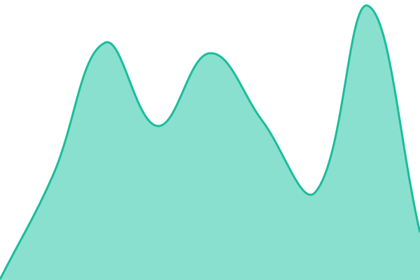

# [📈 Live Status](https://franciscoaldun.github.io/estado-contratochileno): <!--live status--> **🟩 All systems operational**

This repository contains the open-source uptime monitor and status page for [Francisco Aldunate Rodríguez](franciscoaldunate.cl), powered by [Upptime](https://github.com/upptime/upptime).

With [Upptime](https://upptime.js.org), you can get your own unlimited and free uptime monitor and status page, powered entirely by a GitHub repository. We use [Issues](https://github.com/franciscoaldun/estado-contratochileno/issues) as incident reports, [Actions](https://github.com/franciscoaldun/estado-contratochileno/actions) as uptime monitors, and [Pages](https://franciscoaldun.github.io/estado-contratochileno) for the status page.

<!--start: status pages-->
<!-- This summary is generated by Upptime (https://github.com/upptime/upptime) -->
<!-- Do not edit this manually, your changes will be overwritten -->
<!-- prettier-ignore -->
| URL | Status | History | Response Time | Uptime |
| --- | ------ | ------- | ------------- | ------ |
|  [Portada (contrato de arriendo)](https://contratochileno.cl) | 🟩 Up | [portada-contrato-de-arriendo.yml](https://github.com/franciscoaldun/estado-contratochileno/commits/HEAD/history/portada-contrato-de-arriendo.yml) | 

 316ms
     
 | 

<a href="https://franciscoaldun.github.io/estado-contratochileno/history/portada-contrato-de-arriendo">100.00%</a>
    

|  [Poder simple](https://contratochileno.cl/poder-simple) | 🟩 Up | [poder-simple.yml](https://github.com/franciscoaldun/estado-contratochileno/commits/HEAD/history/poder-simple.yml) | 

 316ms
     
 | 

<a href="https://franciscoaldun.github.io/estado-contratochileno/history/poder-simple">100.00%</a>
    

|  [Contrato de trabajo](https://contratochileno.cl/contrato-de-trabajo) | 🟩 Up | [contrato-de-trabajo.yml](https://github.com/franciscoaldun/estado-contratochileno/commits/HEAD/history/contrato-de-trabajo.yml) | 

 262ms
     
 | 

<a href="https://franciscoaldun.github.io/estado-contratochileno/history/contrato-de-trabajo">100.00%</a>
    

|  [Finiquito laboral](https://contratochileno.cl/finiquito-laboral) | 🟩 Up | [finiquito-laboral.yml](https://github.com/franciscoaldun/estado-contratochileno/commits/HEAD/history/finiquito-laboral.yml) | 

 231ms
     
 | 

<a href="https://franciscoaldun.github.io/estado-contratochileno/history/finiquito-laboral">100.00%</a>
    

|  [Contrato de mutuo](https://contratochileno.cl/contrato-de-mutuo) | 🟩 Up | [contrato-de-mutuo.yml](https://github.com/franciscoaldun/estado-contratochileno/commits/HEAD/history/contrato-de-mutuo.yml) | 

 163ms
     
 | 

<a href="https://franciscoaldun.github.io/estado-contratochileno/history/contrato-de-mutuo">100.00%</a>
    

|  [Mapa del sitio](https://contratochileno.cl/sitemap.xml) | 🟩 Up | [mapa-del-sitio.yml](https://github.com/franciscoaldun/estado-contratochileno/commits/HEAD/history/mapa-del-sitio.yml) | 

 191ms
     
 | 

<a href="https://franciscoaldun.github.io/estado-contratochileno/history/mapa-del-sitio">100.00%</a>
    

<!--end: status pages-->

[**Visit our status website →**](https://franciscoaldun.github.io/estado-contratochileno)

## 📄 License

- Powered by: [Upptime](https://github.com/upptime/upptime)
- Code: [MIT](./LICENSE) © [Anand Chowdhary](https://anandchowdhary.com)
- Data in the `./history` directory: [Open Database License](https://opendatacommons.org/licenses/odbl/1-0/)
